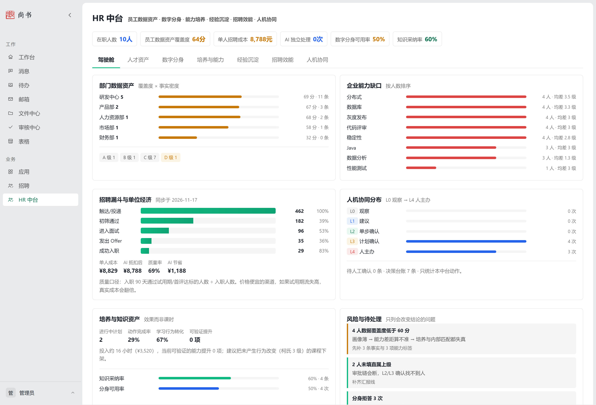
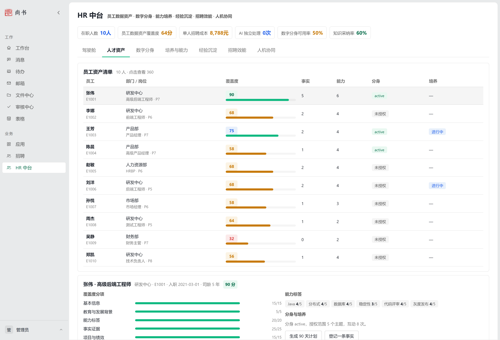
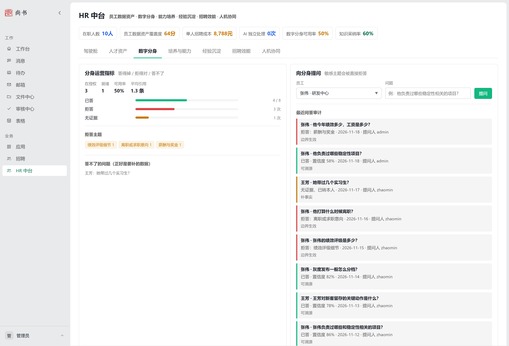
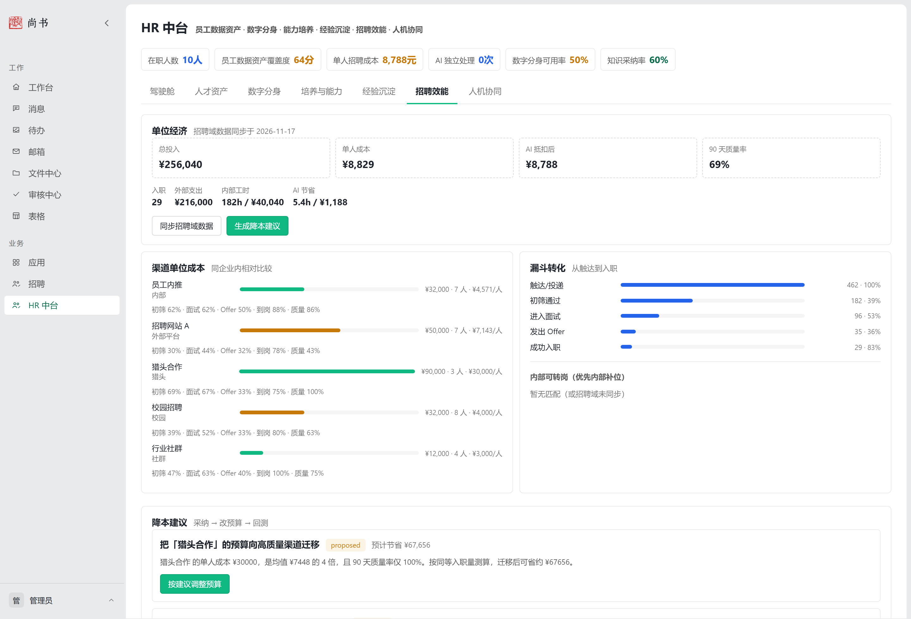
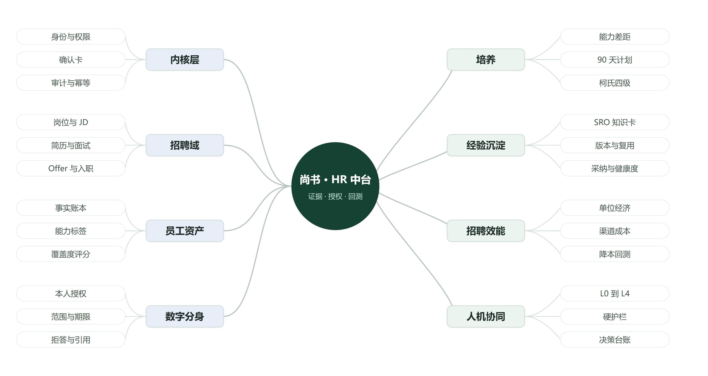
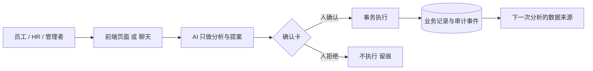

# 尚书 · Sukesong 2.0

**一个把「业务流程」和「AI 同事」放在同一个工作台里的企业平台。**
本仓库当前的重点，是在招聘流水线之上补出的一套 **HR 中台**：把员工散落在项目、复盘、绩效里的经历，沉淀成企业**可核实、可授权、可复用**的数据资产，再在这层资产上做招聘、培养、经验传承，并用「数字分身」让经验随叫随到。

一句话说清它和普通 HR 系统的区别：

> 普通 HR 系统记录**流程走到哪一步**（简历筛了没、合同签了没）；
> 这套中台记录**这个人到底会什么、凭什么这么说、谁能证明**，并且只在这些证据范围内让 AI 说话。



---

## 目录

- [这个项目解决什么问题](#这个项目解决什么问题)
- [你会看到什么](#你会看到什么)
- [产品设计：为什么做，做了什么](#产品设计为什么做做了什么)
- [技术架构](#技术架构)
- [产品价值与设计原理](#产品价值与设计原理)
- [快速开始](#快速开始)
- [仓库结构](#仓库结构)
- [验证边界](#验证边界)

---

## 这个项目解决什么问题

不用懂 HR 术语，看三个日常场景就够了。

**场景一：人走了，本事也走了。**
一个后端工程师在公司干了五年，处理过三次线上故障、带过两个新人、把一套老系统重构完。这些东西散在周报、群聊、代码提交和主管的记忆里。他一离职，公司只剩下一个「高级工程师 P7」的标签。

**场景二：AI 很会说话，但说的不一定是对的事。**
让 AI 回答「我们灰度发布怎么分档」，它能编出一套听起来很专业的流程。员工照着做，出了事故，没人知道这段话是从哪来的。

**场景三：招聘降本，只会砍渠道价。**
把猎头费率从 25% 谈到 20%，看起来省钱了；但猎头来的人三个月就走了一半，重招一次的成本把省下的钱全吃回去。**没有口径，就没有降本，只有搬家。**

这套中台对三件事的答案分别是：

| 问题 | 做法 |
| --- | --- |
| 本事留不下来 | 把「经历」拆成一条条**带来源、带证明人、带时效的事实**，存进企业自己的账本 |
| AI 不可信 | 数字分身只能在**本人授权的范围**内、用**有出处的证据**回答；答不了就转给本人，不猜 |
| 降本靠拍脑袋 | 用**单位经济**算清每个渠道的真实成本与质量，改预算后**同口径回测**，只认数据 |

---

## 你会看到什么

四个界面都是本仓库跑起来的真实页面（演示数据，非设计稿）。

### 1. 驾驶舱：一眼看到「人」的资产状况

（见上方首图）页头六个数字是这家公司的体检结果：在职 10 人、员工数据资产覆盖度 64 分、单人招聘成本 8,788 元、数字分身可用率 50%、知识采纳率 60%。
下面四块图回答四个问题：哪个部门的员工数据最薄、公司整体最缺什么能力、招聘漏斗在哪一层漏得最多、哪些事 AI 已经能自己干。

### 2. 人才资产：点开一个人，看到证据而不是印象



左边是员工清单和覆盖度（分数低不代表人不行，代表**我们对他的了解太少**）。
点开一个人，右侧给出七项覆盖度分项、能力标签（每个标签后面写着「几分之几条事实」）、以及一条条可追溯的经历。**没有事实支撑的标签不会出现。**

### 3. 数字分身：能答、能拒、能转人工



右侧是真实的问答审计记录：问「他绩效多少、工资多少」→ **拒答**（薪酬与绩效属于边界）；问「他负责过哪些稳定性项目」→ **已答，置信度 58%，可溯源**；问「她带过几个实习生」→ **无证据，转本人**。
左侧统计「答得掉 / 拒得对 / 答不了」，并把答不了的问题列成「正好要补的数据」。

### 4. 招聘效能：把钱花在哪、值不值，算清楚



总投入 25.6 万、入职 29 人、单人成本 8,829 元；AI 抵扣后 8,788 元；90 天质量率 69%。
每个渠道都列出初筛→面试→Offer→到岗→质量的转化率与单人成本，最后给一条可执行的建议：把猎头预算迁到高质量渠道，**预计节省 67,656 元**——并且这条建议必须由人确认、改预算、再回测才算数。

---

## 产品设计：为什么做，做了什么

### 为什么做

**判断一：HR 系统的数据，大多不是「关于人的数据」。**
传统系统存的是岗位、编制、合同、考勤、流程状态——都是**管理动作的副产品**。真正决定一家公司能不能干成事的「谁会什么、做成过什么、栽过什么坑」，几乎不在系统里。
所以我们先做一层**员工事实账本**：一条事实 = 一件发生过的事 + 来源 + 时间 + 证明人 + 强度。它是后面所有 AI 能力的地基。

**判断二：没有边界的 AI，在 HR 场景是负资产。**
HR 数据天然敏感：薪酬、绩效、离职意向、健康、家庭情况。一个「什么都能答」的机器人，越能干越危险。
所以数字分身的第一条规则不是「答得好」，而是**「不该答的坚决不答、没证据的不许编、答完必须能溯源」**，授权必须由员工本人给，且有范围和期限。

**判断三：AI Native 不是加一个聊天框，而是重排「谁在什么时候做什么决定」。**
招聘里，AI 可以写 JD、筛简历、排面试、算成本，但**发 Offer、定薪、淘汰必须人拍板**；培养里，AI 可以生成计划，但**是否值得投入、是否算学会了，要人确认并有行为证据**。
所以我们把每件事都标上 L0–L4：观察 / 建议 / 可逆执行 / 计划确认 / 人主办。

### 做了什么（六个模块）

| 模块 | 解决什么 | 关键设计 |
| --- | --- | --- |
| **员工事实账本** | 经历留不下来 | 16 张表；每条事实带来源、时间、强度、证明人；事实确认即背书，18 个月过期；七项覆盖度打分 |
| **数字分身** | 经验问不到、AI 乱答 | 本人授权（L4）、授权范围与期限、敏感主题硬拒答、检索式作答带引用、无证据转本人、全程问答审计 |
| **能力与培养** | 培训上了，能力没变 | 岗位能力模型 → 差距 → 90 天三阶段计划 → 柯氏四级 + 行为转化；只算「可验证的提升」 |
| **经验沉淀** | 老员工的经验带不走 | SRO 知识卡（场景—动作—结果）；同标签 ≥2 条已核实事实才允许起草；发布即新版本，旧版本不覆盖；统计复用率与采纳率 |
| **招聘效能** | 降本无口径 | 单人成本 =（外部支出 + 内部工时 × 220）/ 入职数；质量率 = 90 天达标 / 入职；每质量入职成本；建议→人确认→改预算→同口径回测 |
| **人机协同** | 不知道什么时候该人上 | L0–L4 分级；按风险、可逆性、影响面、置信度、敏感数据五个维度打分；薪酬/绩效/离职/纪律/分身授权默认 L4，只能往上调不能往下调；每次决策进台账 |

### 三个「不做」

- **不替员工说话**：分身不是企业控制的「员工代理」，员工可以随时收回授权。
- **不自动改事实**：AI 只能提案，事实、预算、评级、知识正文都得人确认。
- **不拿大屏当成果**：每个图都要对应一个可执行动作或可回测指标，否则不上首页。

---

## 技术架构

### 能力地图（思维导图）



中心是「证据 · 授权 · 回测」三条底座，八条分支对应八个能力域：内核层与招聘域是已有底座，员工资产、数字分身、培养、经验沉淀、招聘效能、人机协同是本次补上的 HR 中台。

### 一次写操作怎么走（外行版）



**要点只有一句**：AI 的输出永远停在「提案」，跨过写操作必须经过确认卡，确认记录与执行结果都进审计。这条链路是招聘域、HR 中台、财务域共用的，不是 HR 自己发明的。

### 代码分层

| 层 | 位置 | 职责 |
| --- | --- | --- |
| 内核 | `shangshu-server/src/core/` | 身份、权限、确认卡契约、幂等、审计、公共记录 |
| 能力 | `shangshu-server/src/capabilities/` | 招聘、HR 中台、发票、表格、文件等，各自注册查询能力与聊天工具 |
| 接口 | `shangshu-server/src/capabilities/hr/router.ts` | `/api/hr` 全套 REST（读接口 + 走确认卡的写接口） |
| 前端 | `shangshu-web/js/domains/hr/` | 七个 Tab，按域注册约定挂载，写操作统一弹确认卡 |
| 文档 | `docs/domains/hr/` | 蓝图与开发边界，防止后来者绕过内核 |

---

## 产品价值与设计原理

### 价值怎么衡量

| 价值 | 指标 | 演示数据 |
| --- | --- | --- |
| 员工数据不再随人流失 | 资产覆盖度（七项加权） | 64 分；4 人低于 60 分被点名 |
| 经验可以复用 | 知识采纳率、分身可用率 | 60%、50% |
| 招聘花得更值 | 单人成本、90 天质量率、每质量入职成本 | 8,788 元、69%、¥1,188 节省 |
| AI 真的替人干活 | AI 独立处理次数、人确认次数 | 0 次独立、4 次计划确认、3 次人主办 |
| 风险可控 | 未填直属上级人数、覆盖度不足人数、分身拒答次数 | 2 人、4 人、3 次 |

> 演示数据全部由 `seed.ts` 幂等写入，只用于展示口径与交互，**不代表任何真实企业**。

### 五条设计原理

1. **证据优先于结论。** 先有事实，才有标签、评分、建议。分数低先补数据，不先给人下判断。
2. **授权先于便利。** 分身能答什么，由员工本人划定；范围、期限、撤回都写进契约。
3. **AI 提案，人拍板。** 不可逆、涉及钱和人的决定，一律 L4；系统只负责把选项和代价摆清楚。
4. **可逆优先。** 能小步试的就小步试：先改一个渠道预算、先跑一期培养计划，再回测。
5. **衡量替代叙事。** 「提升了员工体验」不算成果；「质量率从 55% 到 69%，单人成本降 41 元」才算。

---

## 快速开始

```bash
# 1. 启动服务端（Node 20+）
cd shangshu-server
npm install
npm start
# 默认 http://127.0.0.1:3000 ，可用 PORT 环境变量改端口

# 2. 打开工作台
# 登录账号：admin / admin
# 工作台：http://127.0.0.1:3000/index.html#/dash
# HR 中台：http://127.0.0.1:3000/index.html#/hr
```

首次启动会自动建库并写入幂等演示数据（10 名员工、16 条事实、2 个分身、5 个招聘渠道、回测样本）。重复启动不会重复插入。

> 这是**演示赛道**：数据落在本地，不接真实 HRIS/ATS，不含薪酬带宽、考勤、多租户与字段级权限。接生产前必须补这些，不能直接上线。

---

## 仓库结构

```
frappe_apps/        Frappe 内核与可选业务域（Python）
shangshu-server/    Node / TypeScript BFF：内核、能力、AI 与外部集成
shangshu-web/       静态前端：工作台壳 + 各业务域页面
scripts/            契约检查与测试
ops/                本地容器与运行工具
docs/               架构、公共 API、域蓝图与工程规范
docs/assets/        README 截图
```

HR 中台相关：

- 服务端：`shangshu-server/src/capabilities/hr/`（14 个模块：表结构、资产、分身、培养、知识、分级、效能、分析、契约、聊天工具、路由、种子、注册）
- 前端：`shangshu-web/js/domains/hr/hr.js`、`css/domains/hr/hr.css`
- 蓝图：`docs/domains/hr/HR-MIDPLATFORM-BLUEPRINT.md`
- 开发边界：`docs/domains/hr/AGENTS.md`

---

## 验证边界

本仓库是移除特定行业扩展和客户资料后的独立源码快照，不包含原 Git 历史、客户业务数据、运行库或凭据；旧部署记录与客户验收证据不随导出携带。

**本次 HR 中台改动已验证：**

- `capabilities/hr` 类型检查 0 错误；
- 7 个读接口与计划发布、事实登记、分身授权、学习记录、知识采集/发布/复用、招聘同步/建议/改预算/回测、分级试算/调整、分身问答（含敏感拒答）冒烟通过；
- 七个 Tab 在真实数据下渲染无异常；
- 截图均来自本仓库服务端 + 前端实际运行页面。

**仍未验证：** 全仓库类型检查未通过，报错位于 `src/core/chat.ts`、`src/core/config.ts`、`src/core/infra/pi-chat.ts`（AI 消息 content 联合类型），与原始开发副本一致，未在本次修复；未执行完整实库、并发、大表性能与部署验收；会话证据关联等开发候选能力尚未合入主线。**不宣称生产可用。**

## 统一日志与经验沉淀

统一日志记录操作事实，正式业务值仍以受管记录为准。入口实现位于 `frappe_apps/shangshu_core/shangshu_core/unified_log.py`，机器契约位于同级 `contracts/unified-log-v1.json`。使用公共审计查询能力按当前身份授权读取，不直接查询数据库绕过权限；日志纠错通过追加事件完成。

HR 中台的「经验沉淀」已把这条路线落成可运行模块：授权事实检索 → 有证据引用的经验候选 → 人工审核 → 版本化知识卡 → 相似场景建议。经验不得自行改变业务事实或扩大访问范围。
